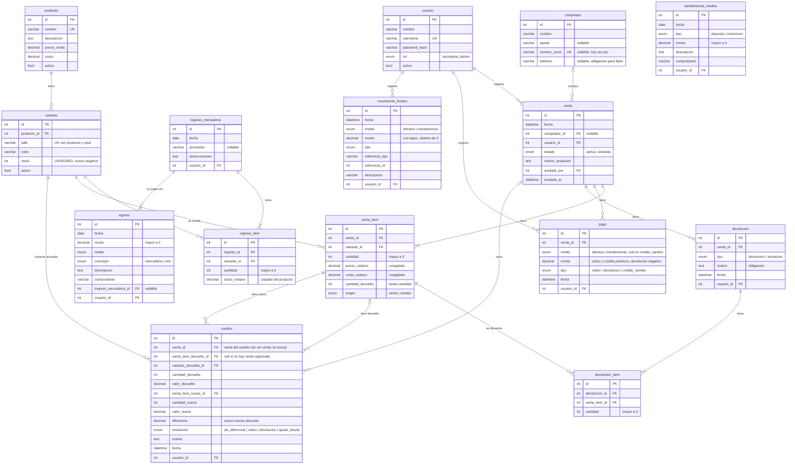

# DER – Sistema de ventas de la tienda del club

Generado a partir de las migraciones de `backend/src/migrations/` (fase 2). Si cambia una migración, hay que actualizar este documento.

Convenciones:
- Todas las tablas tienen `id INT UNSIGNED` autoincremental y `created_at`. Las de catálogo (`usuario`, `producto`, `variante`, `comprador`) tienen además `updated_at`.
- Dinero en `DECIMAL(12,2)`. Fechas en UTC.
- Todas las claves foráneas son `ON DELETE RESTRICT`: **nada se borra** (principio 1).
- El saldo, el total de la venta, la deuda y el estado de pago **no se guardan**: se calculan (principios 5 y 6).

Por claridad, el diagrama no muestra todas las relaciones con `usuario`. Todas las tablas operativas (`ingreso_mercaderia`, `venta`, `pago`, `devolucion`, `cambio`, `egreso`, `transferencia_medios` y `movimiento_fondos`) tienen `usuario_id`, y `venta.anulada_por` también apunta a `usuario`.

## `movimiento_fondos`

Es el libro de caja virtual: el saldo de cada medio es `SUM(monto) WHERE medio = ?`.

| `tipo` | Signo | Medio | `referencia_tipo` |
|---|---|---|---|
| `cobro_venta` | + | el del pago | `pago` |
| `cobro_fiado` | + | el del pago | `pago` |
| `cobro_diferencia_cambio` | + | el del pago | `pago` |
| `devolucion_diferencia_cambio` | − | el del reintegro | `pago` |
| `devolucion_anulacion` | − | el del reintegro | `pago` |
| `egreso` | − | el del egreso | `egreso` |
| `prestamo_recibido` | + | el elegido | — |
| `devolucion_prestamo` | − | el elegido | — |
| `deposito_bancario` | − efectivo / + transferencia | ambos (2 filas) | `transferencia_medios` |
| `extraccion_bancaria` | − transferencia / + efectivo | ambos (2 filas) | `transferencia_medios` |
| `saldo_inicial` | ± | el elegido | — (arranque, tarea 17.2) |

Deuda con la comisión directiva = Σ `prestamo_recibido` − |Σ `devolucion_prestamo`|.

## Restricciones CHECK

| Tabla | Regla |
|---|---|
| `producto` | `precio_venta >= 0 AND costo >= 0` |
| `ingreso_item` | `cantidad > 0 AND costo_unitario >= 0` |
| `venta_item` | `cantidad > 0 AND cantidad_devuelta <= cantidad`, precio y costo `>= 0` |
| `pago` | cobro con `monto > 0` y medio; devolución con `monto < 0` y medio; crédito de cambio con `monto > 0` y sin medio |
| `devolucion` | motivo no vacío |
| `devolucion_item` | `cantidad > 0` |
| `cambio` | cantidades `> 0`, valores `>= 0`, `diferencia = valor_nuevo − valor_devuelto` |
| `egreso`, `transferencia_medios` | `monto > 0` |
| `movimiento_fondos` | `monto <> 0` |

## Diferencias con el borrador de las reglas (sección 15)

- `venta` no guarda `total`: se calcula de los ítems (principio 6).
- Se agregan `devolucion` y `devolucion_item` (tarea 2.10). `devolucion.tipo` distingue una devolución parcial de una anulación, para el reporte 11.5.
- `cambio` guarda cantidades y valores de cada lado (`cantidad_devuelta` / `cantidad_nueva`, `valor_devuelto` / `valor_nuevo`).
- `movimiento_fondos.tipo` suma `saldo_inicial`, para cargar el dinero con el que arranca la tienda (17.2).
- `comprador.apodo` (reglas v1.2): los compradores se conocen por nombre o apodo; para fiado hace falta el teléfono.

## Cómo se registran los cambios de prenda

- **Con venta registrada (9.1):** en la misma venta, el ítem original suma `cantidad_devuelta` y se agrega un ítem nuevo con `origen = 'cambio'`, a precio y costo actuales. La diferencia se cobra (pagos `cobro`, movimiento `cobro_diferencia_cambio`), se devuelve (pago `devolucion`, movimiento `devolucion_diferencia_cambio`) o ajusta la deuda (sin pagos).
- **Sin venta registrada (9.2):** se crea una **venta nueva** con el ítem nuevo. El valor de la prenda devuelta (a precio actual) entra como pago `credito_cambio`, **sin medio y sin movimiento de fondos**: cuenta como pagado, pero no es dinero que entra ni aparece en los saldos ni en las ventas por medio de pago. `cambio.venta_id` apunta a la venta nueva y `venta_item_devuelto_id` queda en NULL.
